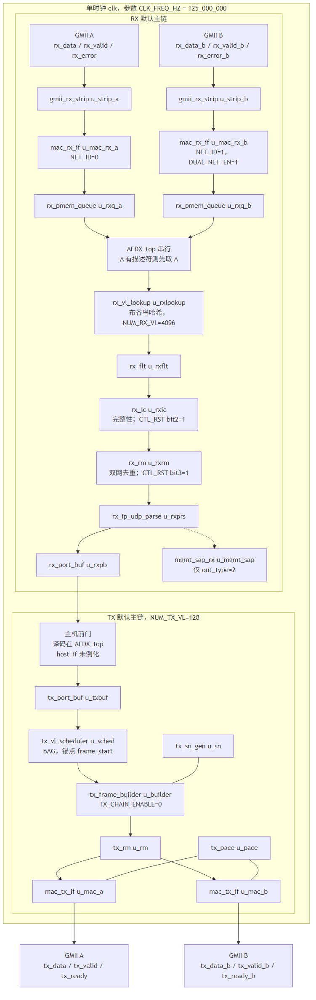

# AFDX 端系统 · 作品总览

> 冻结 `{{metric:freeze_commit}}`（短名 `098efc9`）· 全量 `{{metric:full_pass}}`/`{{metric:full_n}}` · 数字来自 `metrics.json`

**一句话：** 基于 FPGA 的 AFDX（ARINC 664 P7）端系统，公开口 GMII A/B，自建测试台验证收发整形、双网冗余、管理面子集与工程指标。

## 架构



TX：端口 → BAG 调度 → 组帧/SN → 双网 MAC　∥　RX：MAC → 过滤 → IC → RM → 重组 → 主机　∥　管理 SAP（SNMP / TFTP·615A / RTC）

## 五类功能

| 功能 | 关键模块 | 代表测试 | 结果 |
|---|---|---|---|
| 发送调度与整形 | `tx_vl_scheduler` / `mac_tx_if` | T04 / T05* / T27 / T90 | 全量矩阵 PASS |
| 接收过滤与 IC/RM | `rx_vl_lookup` / `rx_ic` / `rx_rm` | T09 / T10 / T12* | PASS（见 metrics） |
| 主机与存储 | `AFDX_top` 前门 / `rx_block_pool` | T01 / T11 / T22 | PASS |
| 管理面子集 | `snmp_lite` / `a615a_tftp` / … | T88 步 5–6；T43 | 子集 PASS |
| 时间同步 | `rtc_sync` | T16a / T88 步 7 | `t16a_pass`=`{{metric:t16a_pass}}` |

## 四项指标（口径一句话）

| 指标 | 赛题要求 | 实测（metric） | 口径 |
|---|---|---|---|
| 吞吐 | 有效载荷 ≥100 Mbps；RX 去重计一次 | T90 `t90_tx_a_mbps`=`{{metric:t90_tx_a_mbps}}`；`t90_rx_dedup_mbps`=`{{metric:t90_rx_dedup_mbps}}` | 128 TX 同时活动；IF_MODE=2 |
| 时延 | 工程 ES 贡献 ≪ 2 ms | T89 `t89_es_total_max_ns`=`{{metric:t89_es_total_max_ns}}` | commit→SFD 与 SFD→host 之和；非官方 SFD→SFD |
| 抖动 | 同 VL max−min | T42 `t42_jitter_max_us`=`{{metric:t42_jitter_max_us}}`；T89 `t89_max_jit_ns`=`{{metric:t89_max_jit_ns}}` | 场景内对照 40+Σ |
| 规模 | 128 TX / 4096 RX 能力 | `t34p_pass`/`t35p_pass`；T90 128 同时 | 4096 为覆盖，非同时收 |

## 验证体系

**{{metric:full_pass}}/{{metric:full_n}}** 双仿真器一致（`dual_sim_match`=`{{metric:dual_sim_match}}`）· 综合后仿真 **T88b 切片**（T91 门级吞吐 **F**，RTL 吞吐旁证另列）· 变异 C3 `{{metric:c3_mutants_killed}}`/`{{metric:c3_mutants_total}}` · 覆盖率双口径（I）· BAG BMC=`{{metric:bmc_bag_grade}}` · 解包 REPLAY

## 三个创新点

1. **全硬件管理面** — SNMP/TFTP·615A/RTC 在 FPGA 内，无软核。  
2. **4096 VL 双表 4-way 流水查表** — 离线摆放 + 常量延迟（T12c）。  
3. **验证方法学** — 黄金模型 · 双仿真器 · 变异 · 形式边界 · 单一数字来源。

## 怎么跑（冒烟）

```powershell
powershell -File sim/run_smoke.ps1
```

详解：`doc/submit/00_先读.md` · 设计/测试正文 · 答辩要点。
